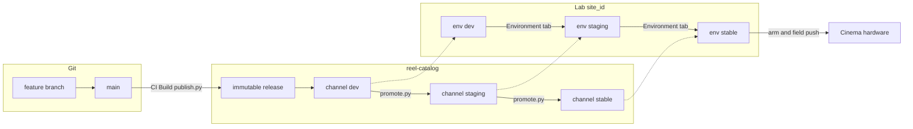

# Reel web-pack SDLC

How a software change moves from a feature branch to a cinema site in the
field — without long-lived `stage` / `production` / `hotfix` git branches.

This document is the reviewable contract for **propagation**, **promotion**,
**hotfix**, and **rollback**. Tooling named here (`publish.py`, `promote.py`,
builder Environment tab) is the intended mechanism; some pieces are already
in this repo, others land in `reel-edge` / `reel-builder` / Infisical later.

---

## 1. Principles

1. **One long-lived git branch: `main`.** Features merge here. There is no
   permanent git `stage`, `production`, or `hotfix` line.
2. **Environments are catalog channels + site env, not git branches.**
   Channels: `dev` → `staging` → `stable`. Production == catalog `stable`.
3. **Releases are immutable.** CI builds a digest-pinned image once and
   records it under a release id (e.g. `2026-10-22T2038Z`). Promotion only
   moves a channel *pointer* to an existing release. Rollback moves the
   pointer back.
4. **One lab/canary `site_id` walks the chain.** Create the site at
   Infisical env=`dev`; promote pack + flip site env together through
   staging to stable; then arm and push to field. Later cinemas enroll on
   `stable` at an armed release — they do not repeat local Vite.
5. **Git tags are optional audit labels**, not the promotion mechanism.
   The source of truth for “what is staging / prod” is
   `products/.../channels/.../{channel}.txt` in this catalog.

---

## 2. Coordinate system

Runtime clients resolve a pin from three values:

```text
PRODUCT   reel-edge | reel-docker | reel-builder | …
VARIANT   cinema | ads | pos | …          (station / web-pack flavour)
CHANNEL   dev | staging | stable | nightly
```

| Layer | What it is | Example (cinema web pack) |
| ----- | ---------- | ------------------------- |
| Git | Source code on `main` (or a short-lived feature branch) | `reel-web` + `reel-edge` SHAs |
| Catalog release | Immutable folder + image digests | `reel-edge/cinema/2026-11-03T1412Z` |
| Catalog channel | Movable pointer to a release id | `channels/cinema/dev.txt` → that id |
| Site | Builder enrollment: `site_id`, channel, Infisical env | Lab site walks env with the pack |
| Field | Armed `stable` release on cinema hardware | Same digests as catalog `stable` |

`reel-web` is not a catalog product. It is baked into the `reel-edge`
**cinema** (or ads/pos) flavour image. The deployable unit is always the
edge image digest under `REEL_EDGE_IMAGE=…@sha256:…`.



---

## 3. Lifecycle: feature → development → staging → production

### 3.1 L0 — Feature branch (local)

| | |
| --- | --- |
| **Git** | Branch off `main` (e.g. `feat/cinema-card`). |
| **Runtime** | Local Vite (or equivalent) for the cinema app. |
| **Site** | Talk to an already **dev-created** site (`site_id`, Infisical env=`dev`). |
| **Catalog** | Nothing published. |
| **Exit** | PR opened; feature-level tests pass against the dev site APIs. |

### 3.2 L1 — Development (pinned VM cut)

| | |
| --- | --- |
| **Git** | PR merged into `main`. |
| **Build** | `reel-edge` **CI Build** flavour-bakes cinema (pulls in `reel-web` at bake time) → pushes GHCR digest → `publish.py` writes a new release and points **`dev`** at it. |
| **Site** | Same lab site stays on channel=`dev` / Infisical env=`dev`. **Reinstall / Web-pack Save** so the VM runs the pinned image (not Vite). |
| **Exit** | Smoke / integration on the non-Vite head cut of `main`. |

Every merge to `main` can move `dev`. Staging and stable do **not** chase
`main` automatically.

### 3.3 L2 — Staging / UAT

| | |
| --- | --- |
| **Promote pack** | `promote.py --from-channel dev --to-channel staging` (or promote an explicit `--release-id`). Same digests; only `staging.txt` moves. |
| **Promote site** | Builder **Environment** tab (or equivalent): flip site channel → `staging`, Infisical env → `staging`, reload keys / backend endpoints, reconcile pack. |
| **Test** | UAT against stage backends, secrets, and the promoted frontend on that same site. |
| **Exit** | Sign-off that this release id is candidate for production. |

No second “stage VM” is required for the lab path: one `site_id` changes
environment.

### 3.4 L3 — Production → arm → field

| | |
| --- | --- |
| **Promote pack** | `promote.py --from-channel staging --to-channel stable`. |
| **Promote site** | Flip lab site to channel=`stable`, Infisical env=`stable` (prod keys). |
| **Arm** | Ops gate: freeze the release id as field-ready (checklist / builder “Arm”). Optional git tag for humans, e.g. `cinema-stable-2026-11-03T1412Z`. |
| **Field** | Push / enroll cinema hardware on catalog `stable` at that release. Later sites enroll directly on `stable` — they skip L0/L1 Vite. |

**Production is catalog `stable` + site env=`stable`.** It is not “whatever
is on git `main` right now.”

---

## 4. How promotion works

Promotion is deliberately boring:

```text
publish.py   → creates immutable release + moves `dev` (CI Build)
promote.py   → moves `staging` or `stable` to an *existing* release id
                 (no rebuild, no new digest)
```

### 4.1 Pack promote (catalog)

```bash
# After L1 soak on the lab site
python3 scripts/promote.py \
  --catalog-root . \
  --product reel-edge --variant cinema \
  --from-channel dev --to-channel staging

# After L2 UAT
python3 scripts/promote.py \
  --catalog-root . \
  --product reel-edge --variant cinema \
  --from-channel staging --to-channel stable
```

Or pin an exact cut (recommended when `dev` may have moved since you tested):

```bash
python3 scripts/promote.py \
  --catalog-root . \
  --product reel-edge --variant cinema \
  --release-id 2026-11-03T1412Z --to-channel staging
```

Rules:

- `--to-channel` is only `staging` or `stable` (`dev` / `nightly` stay CI-owned).
- Target release must already exist under `products/<product>/releases/<variant>/`.
- Idempotent if the channel already points at that release.
- Intended CI shape: `workflow_dispatch` on the product repo that checks out
  this catalog, runs `promote.py`, commits the pointer file.

### 4.2 Site promote (builder + Infisical)

On the **same** `site_id`:

1. Set channel to the target (`staging` or `stable`).
2. Flip Infisical env tag / folder (`dev` → `staging` → `stable`) so keys and
   backend URLs match that environment.
3. Re-inject secrets and Web-pack Save / reconcile so the VM pulls the
   channel tip (or the armed release id).

The Environment tab is the operator UX for steps 1–3 (and may call pack
promote first).

### 4.3 What we do *not* promote via git

| Avoid | Why |
| ----- | --- |
| Merge `main` → git `stage` | Staging is a catalog pointer + site env |
| Merge `stage` → git `production` | Production is catalog `stable` |
| Permanent `hotfix` branch | Short-lived branch from the prod *source SHA*, then back to `main` |

Optional **tags** at arm time are fine for humans and release notes. Tags
do not replace channel pointers.

---

## 5. Worked example — “Cinema card” feature

Scenario: add a new **Cinema card** component to the cinema web app
(`reel-web`), served from the `reel-edge` cinema web pack.

### Step A — Feature on Vite (L0)

1. Create `feat/cinema-card` from `main` in `reel-web` (and `reel-edge` if
   pack wiring changes).
2. Ensure a lab site exists at Infisical env=`dev` (create via builder if
   needed).
3. Run Vite locally; point API / site config at that lab site.
4. Implement the card; exercise it against the live dev site backends.
5. Open PR(s) → review → merge to `main`.

### Step B — Dev pin on the VM (L1)

1. Merge triggers `reel-edge` **CI Build** → cinema flavour bake → new
   release, e.g. `2026-11-03T1412Z`, channel **`dev`** updated.
2. On the lab site (still env=`dev`): **Add / Save web pack** so the VM
   runs `REEL_EDGE_IMAGE@sha256:…` from that release (not Vite).
3. Verify the Cinema card on the pinned site URL. Fix forward on `main` if
   needed (each fix = new `dev` pin).

### Step C — Promote to staging (L2)

1. Note the release id you tested (do not blindly promote “whatever `dev`
   is now” if more merges landed). Prefer:

   ```bash
   promote.py … --release-id 2026-11-03T1412Z --to-channel staging
   ```

2. Environment tab → **Staging**: site channel + Infisical env → `staging`,
   reload keys, reconcile pack.
3. UAT: Cinema card against stage backends, stage secrets, stage URLs.
4. Sign off.

### Step D — Promote to production and field (L3)

1. `promote.py … --release-id 2026-11-03T1412Z --to-channel stable`
   (or `--from-channel staging` if staging tip is still that id).
2. Environment tab → **Production**: site env → `stable`, prod keys.
3. **Arm** release `2026-11-03T1412Z`.
4. **Push to field**: enroll / flash / reconcile cinema hardware on
   `stable`. Optional tag `cinema-stable-2026-11-03T1412Z` for the notes.

At this point the Cinema card in production is exactly the digest tested in
staging — not a rebuild.

---

## 6. Hotfix a production bug

Goal: fix a bug that is live on **catalog `stable`**, get it to field
safely, and keep `main` honest so the next normal release still contains
the fix — **without** a permanent hotfix branch.

### 6.1 Identify the production cut

Read the stable pointer and its provenance:

```text
products/reel-edge/channels/cinema/stable.txt
  → 2026-11-03T1412Z

products/reel-edge/releases/cinema/2026-11-03T1412Z/release.json
  → source.repo / source.sha   (the git commit baked into that image)
```

### 6.2 Fix from the frozen SHA (short-lived branch)

```text
git checkout -b fix/cinema-card-crash <source.sha from release.json>
# or from main if tip still contains that release and little else risky
… fix …
PR → main
```

Merge to `main`. CI publishes a **new** release on catalog **`dev`**
(e.g. `2026-11-04T0915Z`). The hotfix commit is now on `main`, so every
future feature bake includes it.

### 6.3 Promote the hotfix like any other release

Same gates, usually faster soak:

```text
L1  reinstall pack on lab site (dev) → verify fix on VM pin
L2  promote release id → staging; flip site to staging; short UAT
L3  promote → stable; flip site to stable; arm; push field
```

Emergency path (still no rebuild-at-promote): after a minimal staging
check, promote the **same** release id straight to `stable` with
`--release-id 2026-11-04T0915Z --to-channel stable`. Prefer not to skip
staging unless the incident requires it.

### 6.4 “Next production release”

Because the fix landed on `main`:

- The next feature (e.g. another cinema UI change) merges → new `dev` pin
  that **already contains** the hotfix.
- Promoting that later release to `stable` does not re-introduce the bug.
- No need to merge a `hotfix` branch into `stage`/`prod` lines — those
  lines do not exist.

### 6.5 If `main` has unrelated unfinished work

You still avoid a permanent hotfix branch:

1. Branch from the **production source SHA**.
2. Land the fix; open PR to `main` (so history stays linear when ready).
3. For the emergency bake only: have CI build from that fix SHA / PR merge
   commit and publish to `dev`, then promote that release id through
   staging → stable.
4. Unrelated `main` work continues separately and promotes later as its
   own release ids.

---

## 7. Rollback

Because releases are immutable and channels are pointers, rollback is the
same operation as promote — aimed at an **older** release id.

### 7.1 Pack rollback

Example: `stable` was moved to `2026-11-04T0915Z` and misbehaves; previous
good cut was `2026-11-03T1412Z`.

```bash
python3 scripts/promote.py \
  --catalog-root . \
  --product reel-edge --variant cinema \
  --release-id 2026-11-03T1412Z \
  --to-channel stable
```

Then reconcile / Web-pack Save on affected sites so they pull the older
digest. No image rebuild; GHCR still holds both digests.

The same pattern applies to `staging` if UAT needs to step back.

### 7.2 Site / secrets rollback

- **Pack-only rollback:** leave Infisical env=`stable`, only change which
  release `stable` (or the site’s pinned release) points at.
- **Env rollback (rare):** flip the lab site back to `staging` / `dev` if
  you must re-enter UAT with stage keys — that is a site env change, not a
  catalog rewrite.

### 7.3 What rollback does *not* require

- Reverting git `main` (optional later for hygiene; not required to restore
  field behaviour).
- Re-baking the old release (the release tree and digests never moved).
- A special “rollback tag” — the previous release id *is* the rollback
  target. Tags are optional labels on top.

### 7.4 Operational habits that make rollback safe

1. **Always promote by release id** once you leave pure `dev` chasing, so
   you know exactly which cut staging/stable reference.
2. **Keep prior stable release ids** in the catalog (never delete release
   folders).
3. **Arm** records the release id pushed to field — that id is the first
   rollback candidate.
4. Prefer moving `stable` only after staging sign-off so rollback targets
   are known-good UAT cuts.

---

## 8. Channel vs tag cheat-sheet

| Mechanism | Role | Moves when |
| --------- | ---- | ---------- |
| Git branch `main` | Integration source | Every merged PR |
| Feature / fix branch | Short-lived work | Deleted after merge |
| Catalog release id | Immutable artifact | Created once by `publish.py` |
| Channel `dev` | Hot head cut | Every CI Build publish |
| Channel `staging` | UAT cut | Explicit `promote.py` |
| Channel `stable` | Production cut | Explicit `promote.py` |
| Git tag (optional) | Human/audit label at arm | Never required for resolve |
| Site Infisical env | Secrets + backend URLs | Environment tab with promote |

Devices resolve **channel → release id → digest**. Tags are not in that
path.

---

## 9. Responsibility map

| Step | Who / what |
| ---- | ---------- |
| Feature + Vite vs lab site | Developer (`reel-web` / `reel-edge`) |
| Merge to `main` | PR review |
| Publish to catalog `dev` | Product CI (`publish.py`) |
| Reinstall pack on lab VM | Operator / developer (builder) |
| Promote channel pointer | `promote.py` via workflow_dispatch or CLI |
| Flip site env + keys | Builder Environment tab + Infisical |
| Arm | Ops / builder checklist |
| Field push | Ops (`reel-os` / enroll / reconcile) |
| Rollback channel tip | Same promote path with older `--release-id` |

---

## 10. Out of scope for this document (follow-ups)

These realise the UX described above but are not required to agree the
model:

- `workflow_dispatch` **Promote** job on `reel-edge` (and siblings).
- Builder **Environment** tab wiring (promote + Infisical flip + reconcile).
- Vite → lab-site env templates in `reel-web`.
- Arm + field-push automation.

Catalog pieces that already support the model: channel layout,
`scripts/publish.py`, `scripts/promote.py`, and this SDLC.

---

## 11. Quick FAQ

**Do we need git `stage` / `production` / `hotfix` branches?**  
No. Channels + site env replace them. Short-lived fix branches from the
prod source SHA are enough for incidents.

**Is `main` production?**  
No. `main` feeds catalog `dev`. Production is catalog `stable`.

**Does promote rebuild the image?**  
No. Same digest; pointer move only.

**How do we roll back?**  
Point `stable` (or `staging`) at a previous release id with `promote.py`,
then reconcile sites.

**How does a hotfix get into the “next” release?**  
It merges to `main`, so the next `dev` bake already contains it; that
later release promotes through staging → stable like any feature.
